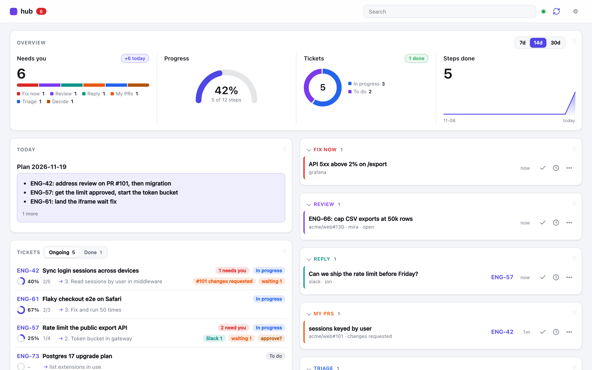
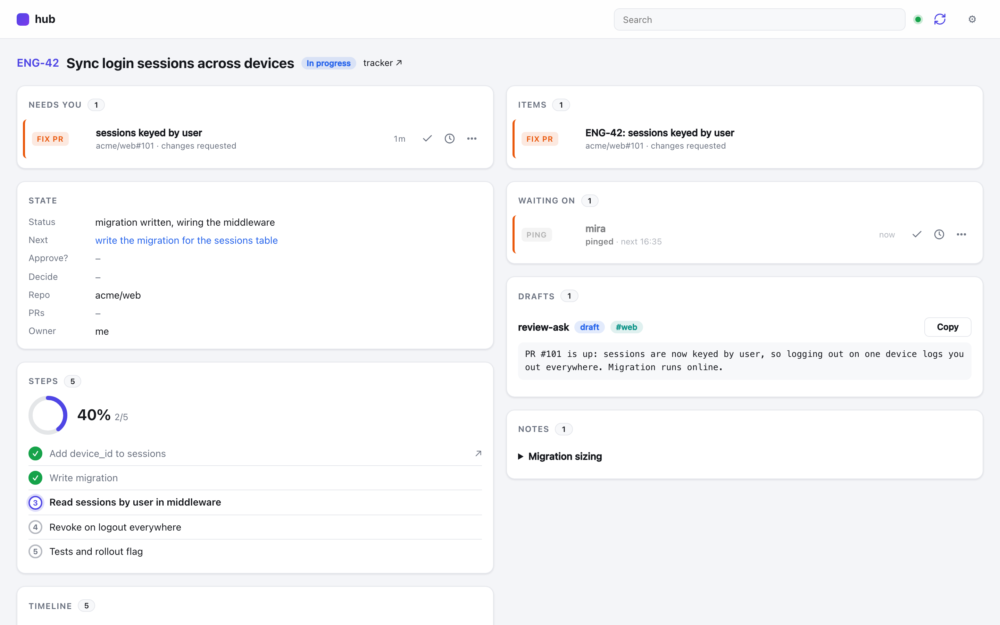

# engineer-hub

A local work record for one engineer's tickets, kept in one SQLite file and read and written by coding agents through a compact CLI, `hub`.

Agents that keep ticket state in markdown re-read the whole file for every edit, and free-form state grows until a cold start costs thousands of tokens per ticket. `hub` keeps state, timeline, notes, drafts, day plans and the PRs, threads, review requests and alerts of each ticket in one database, caps state fields at one line, and answers "status" and "what is next" in a few short lines.



## Install

Needs Node.js 24 or newer (`node:sqlite` with FTS5 and native TypeScript type stripping). No runtime dependencies.

```sh
git clone https://github.com/nhkhai-vn/engineer-hub
cd engineer-hub
ln -s "$PWD/src/cli.ts" ~/.local/bin/hub   # any folder on PATH
hub service install                         # macOS; elsewhere run hub serve under a supervisor
hub board
```

`hub serve` is the only process that opens the database (`~/.hub/hub.db`, or `HUB_DB` / `--db <path>`). The CLI, the dashboard and every agent go through its API at `http://127.0.0.1:7420`.

For Claude Code, install the plugin for the hub MCP tools and the sync and plan skills:

```
/plugin install engineer-hub --marketplace nhkhai-vn/engineer-hub
```

## Example

```sh
hub ticket-new ENG-42 "Sync login sessions across devices" --dir inprogress
hub set ENG-42 next "write the migration for the sessions table"
hub set ENG-42 gate "waiting on design review"
hub log ENG-42 "read the session middleware; sessions are keyed by device id"
hub link ENG-42 https://github.com/acme/web/pull/101
hub board
```

```
== inprogress
  [-] ENG-42 | - | GATE: waiting on design review | next: write the migration for the sessions table
```

Each ticket has its own page with state, steps, timeline, items, waits, drafts and notes:



## Docs

- [CLI](docs/cli.md): every command, field limits, config keys, importing a markdown ticket folder
- [Sources](docs/sources.md): GitHub, Linear and Slack fetched by hub itself, script sources, items from agent connectors
- [Dashboard](docs/dashboard.md): the page, the macOS service, Sync and auto sync
- [Agents](docs/agents.md): the Claude Code plugin and hooks, instructions for agents, the MCP server and the JSON API

## Development

```sh
npm ci
npm run type-check && npm run lint && npm test
```

## License

Apache-2.0
