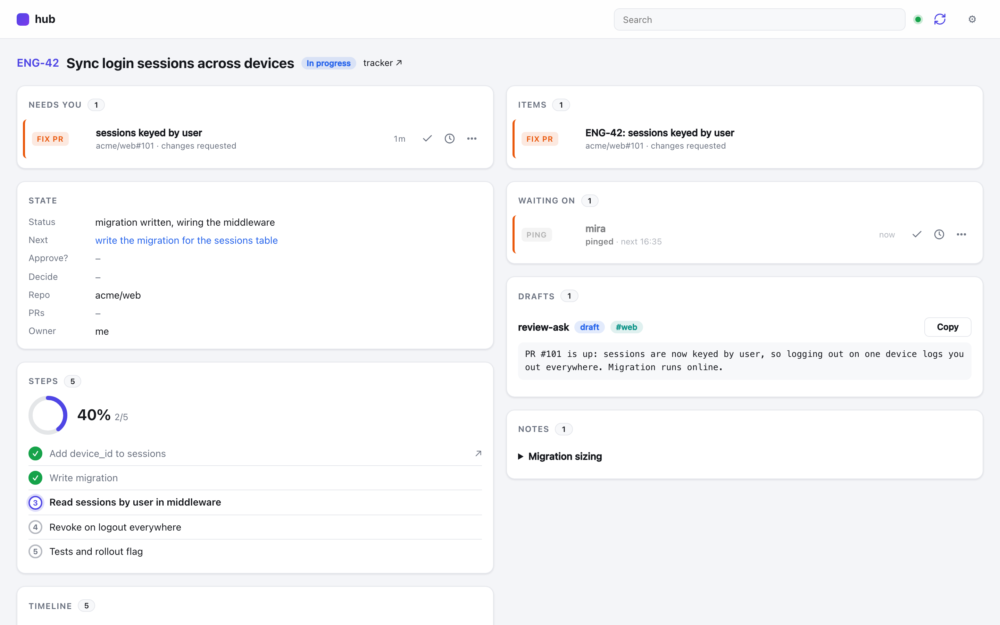

# Dashboard


```sh
hub serve                # http://127.0.0.1:7420, --port to change
hub service install      # macOS: run hub serve at login and restart it if it stops
hub service status       # running (pid) or not installed; exit 1 when not running
hub service uninstall
```

`hub serve` is the only process that opens the database (`~/.hub/hub.db`; `HUB_DB` or `--db <path>` points elsewhere, created on first start). Every other command, and every agent, goes through it: the CLI calls its API at `http://127.0.0.1:7420` (`HUB_URL` for another) with the token next to the database, and says so when it is not running. The CLI sends the database path it was pointed at, and a hub serving another database refuses. `hub config syncCommand` is the one write made straight to the file, since the API refuses keys that run commands.

The service runs `hub serve` with the `--db` and `--port` given at install and the `PATH` of the shell that installed it (so Sync finds `claude`), and logs to `serve.log` next to the database. On Linux, run `hub serve` under a systemd user unit or another supervisor. The write token lives in `token` next to the database (mode 600, made on first start) and stays the same across restarts; delete the file for a new one.

A live page on this machine only: what needs you (review requests, mentions, alerts, pings that are due, proposed draft matches, gates), every open ticket with step progress, next step, PR and Slack chips, today's plan, drafts with Copy and Sent, and what changed since yesterday; one page per ticket with state, steps, timeline, items, waits, drafts and notes. Any write, from the CLI, an agent or the page, shows within a second. Text fields (titles, next, gate, decide, steps, log lines) render markdown: code, bold and links on one line in the lists, in full in the ticket page's State. A ticket row shows its first three PRs and folds the rest behind +N; a long ticket id is cut with … and shows whole on hover.



A full-width top row holds the Overview: how many things need you, split by category (a click jumps to that card), the share of steps done across open tickets as a gauge, open tickets by state as a donut, and steps done per day as a line chart with the change against the previous period (7, 14 or 30 days, switched in the card). Below it are two columns. What needs you is split into cards by what to do: Pinned, Fix now (alerts), Review, Reply (messages and sent-draft checks), My PRs, Triage, Waiting on (pings due), Decide (approve? and decide), each with a count; a click on a card title folds it and the browser remembers. The total sits next to the hub logo, and a ticket with open rows shows "2 need you" (its page lists them). Every card, Tickets, Today, Drafts and Activity can be dragged by the grip at its top right to any place in the top row or either column, or moved or hidden with the grip menu; the order is stored in the `layout` config key, and Settings shows or hides each card and has Reset. Ticket progress is a ring with the percentage by default (Settings: ring, half circle or bar). Every row ends in the same three controls: ✓ handled (done, or answered for a ping), a clock for later (snooze, or "pinged, remind me"; one click means tomorrow 09:00, Settings: 7:00 to 10:00) and ⋯ (pin to top, snooze 1 hour, 4 hours or until tomorrow, open, copy link; on review requests and your PRs also Ignore this PR and Ignore review requests / my PRs from the repo: hidden for good whatever changes, listed under Settings → Sources with Undo). Questions (is this your sent draft? approve?) are answered with Yes / No under the title. A draft with a send time waits dimmed in Drafts with its time; once due it is a Send row under Reply with Copy, ✓ Sent and the clock for later. Done, snoozed and answered rows stay in place, dimmed, with Undo, while the page is open; after a reload they sit in a folded "Done & snoozed" line at the end of their group until the day ends. Today shows its first 3 list items, draft bodies show one line until clicked, Activity shows the last 5, and the header names only sources that are failing or stale. Drag an Ongoing ticket up or down within its folder to set your order (the same as `hub order`). Tickets has two tabs: Ongoing, and Done for tickets finished in the last 14 days (Settings: 7, 14 or 30). The tab title and icon carry the count, new rows flash, and with notifications on (Settings) a background tab raises a browser notification. Settings (`/settings`, or `,`) choose browser or app for Slack and Linear links, notifications, sound, theme, time zone and the sync command, and show the database path. Sync is the round-arrows icon in the header (it spins while a run is going; hover shows the elapsed time). Auto sync is on by default: `hub serve` starts the same run every 4 hours after the last one (Settings → Sync: off, or 15 min to 4 hours; config `autoSync`, `syncEvery`), since hub fetches GitHub, Linear, Slack and script sources itself every minute. Each run is a headless Claude session and uses plan quota. The search box in the header (`/`) finds tickets, items, steps, notes, drafts and log lines as you type; arrows pick, Enter opens, Esc clears. Keys: `j`/`k` move, `Enter` opens, `e` handled, `s` later, `y`/`n` yes or no, `p` pin, `u` undo, `/` search, `,` settings (again to go back).

Sync runs `syncCommand` (default `claude -p /engineer-hub:hub-sync` with the hub MCP tools and `gh` read commands allowed), once at a time, with `HUB_DB` and `HUB_URL` pointing at the serving hub. Each run spends Claude usage. A headless run can use only the tools it is allowed, so add each connector you sync from:

```sh
hub config syncCommand '["claude","-p","/engineer-hub:hub-sync","--allowedTools","mcp__plugin_engineer-hub_hub,Bash(gh search:*),Bash(gh pr view:*),mcp__claude_ai_Slack,mcp__claude_ai_Linear,mcp__claude_ai_Gmail"]'
```
