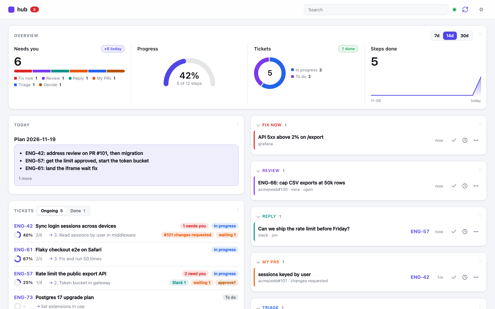

# Dashboard



```sh
hub serve                # http://127.0.0.1:7420, --port to change
hub service install      # macOS: run hub serve at login and restart it if it stops
hub service status       # running (pid) or not installed; exit 1 when not running
hub service uninstall
```

A Homebrew install runs it with `brew services start engineer-hub` instead, since `hub service install` would point launchd at a versioned path that the next `brew upgrade` removes.

`hub serve` is the only process that opens the database (`~/.hub/hub.db`; `HUB_DB` or `--db <path>` points elsewhere, created on first start). Every other command, and every agent, goes through it: the CLI calls its API at `http://127.0.0.1:7420` (`HUB_URL` for another) with the token next to the database, and says so when it is not running. The CLI sends the database path it was pointed at, and a hub serving another database refuses. `hub config syncCommand` is the one write made straight to the file, since the API refuses keys that run commands.

The database is the only copy of your tickets, so `hub serve` backs it up: once a day by default into `backups/` next to it (`hub-YYYYMMDD-HHMMSS.db`, UTC, mode 600), keeping the newest 14. Settings → Database switches it off, sets the schedule (1 hour to 7 days), the number kept and the folder; point the folder at a synced or external drive (`~/Library/Mobile Documents/com~apple~CloudDocs/hub`, say) so a backup outlives the disk. A failed backup shows as "backup failed" in the header. `hub backup` backs up now, `hub backups` lists them, and `hub restore <name>` saves the current database as a `-before-restore` backup and then swaps the named one in without stopping hub. A backup from an older hub is upgraded when restored and one from a newer hub is refused; to move to a new machine, copy a backup in as `hub.db` before the first `hub serve`.

Away pings reach you off the Mac. With Settings → Away → Ping when away on (config `awayPing`), `hub serve` checks every minute whether you are away (macOS idle over `awayAfter`, 10 minutes by default, or the screen locked; never on Linux). While away, it posts the count of new alerts and new messages that need you (Slack DMs, mentions and replies, Linear mentions and comments, answered waits, mail), counted from your last keyboard or mouse input, to a webhook: a Slack incoming webhook, or any URL that takes a JSON post. A one-shot judge picks which of them are worth it: hub runs `judgeCommand` (default `claude -p --model haiku --max-turns 1` with no tools, MCP servers, settings, session or thinking, in `judge/` next to the database) with the rules in `judgePrompt`, the candidates (id, kind, where, who, repeats, first 200 characters), your open tickets and your PRs merged in the last `watchFor` (3 hours) on stdin, and reads back `{"<id>": {"ping": true, "why": "..."}}`. Each row is judged once; with nothing new there is no call. Measured: about $0.002 and 3 seconds a call (API-equivalent; on a plan it counts against plan usage). The post names where, who and the judge's why, never message text:

```
hub: 2 need you
Reply: #corpit_help-desk (kida_tatsuya), asks to confirm app scopes
Fix now: #tech_alert_critical (Grafana) ×3, alert matches ENG-12 after infra#5433 merge
```

An id the judge leaves out is posted with "no verdict". When the judge fails (exit code, timeout, no JSON), hub posts the count, `hub: 3 new | Fix now 1 | Reply 2, judge failed`, then one line per item in the same shape with its text in place of the verdict (`Fix now: #alerts (Grafana) ×2, API 5xx above 2%`), so a broken judge never silences an alert; with `judgeCommand` set to `[]` it always posts the count and lines. The model never posts or writes to hub. Repeats count once: messages from the same sender in the same place, and alerts whose titles differ only in numbers, within 2 hours. At most one post per `awayEvery` (30 minutes); what arrives meanwhile goes in the next, and a failed post is retried on the next check. The URL is a key, so it is stored like one and never typed into the page: `security add-generic-password -s engineer-hub -a webhook -w` (`HUB_WEBHOOK_KEY` off macOS). Settings shows whether it is stored, the last post or error, the judge command, its last run or error, the rules (editable) and the merged-PR window, and Test, which posts a sample in the same shape as a real ping (`hub test: 2 need you` and two sample lines, or `hub test: 3 new | Fix now 1 | Reply 2` and three sample lines without a judge); agents cannot post (not an MCP tool).

The service runs `hub serve` with the `--db` and `--port` given at install and the `PATH` of the shell that installed it (so Sync finds `claude`), and logs to `serve.log` next to the database. On Linux, run `hub serve` under a systemd user unit or another supervisor. The write token lives in `token` next to the database (mode 600, made on first start) and stays the same across restarts; delete the file for a new one.

A live page on this machine only: what needs you (review requests, mentions, alerts, pings that are due, proposed draft matches, gates), every open ticket with step progress, next step, PR and Slack chips, today's plan, every unsent draft once with Copy and Sent (on the row of the PR, review request or message it answers while that row is open, else a Send row under Reply; a review draft also shows its verdict and, unfolded, its text and each `file:line` comment with its own Copy), and what changed in the period; one page per ticket with state, steps, timeline, items, waits, drafts and notes. On the ticket page, the ⋯ next to the title edits the title, changes the id, merges the ticket into another or deletes it (asking first; merge and delete back up the database first); the ⋯ on a step edits it, marks it not done or removes it; an item row has the same ✓, clock and ⋯ as on the dashboard, with Detach in its ⋯ (items are handled there, so the page's Needs you leaves them out, as it does waits); a draft has Copy and Sent (Not sent once sent) like on the dashboard, drafts on the ticket's items show here too, and its ⋯ renames it or removes an unsent one; inside an open note copies its markdown, opens it as a new GitHub issue (title and body filled in the ticket's `repo` when that is `owner/name`, else `issueRepo`; you submit it; a body too long for a link is copied and the issue opens with the title only), renames or removes it. A ticket with one note opens it. Empty state fields are left out, the tracker link shows only when the ticket has one, and Steps, Items, Waiting on and Drafts with nothing in them fold into one line ("No steps, items, waits or drafts"). Any write, from the CLI, an agent or the page, shows within a second. Text fields (titles, next, gate, decide, steps, log lines, draft labels and bodies, note titles) render markdown: code, bold, italic, strikethrough and links on one line in the lists and folded rows, in full (with nested lists and GFM tables, which scroll sideways when wide) in the ticket page's State, notes, today's plan and opened rows; Copy still copies the draft's raw text. Settings shows the sync command and source setup commands as code blocks. The ticket page shows the tracker's state next to the folder only when it says something else, named by its tracker ("Linear: In Review"). A ticket's tracker priority shows as bars before its id (one, two or three for low, medium and high; a red ! for urgent). A ticket row shows its first three PRs as `#N` chips coloured by state (hover names the state) and folds the rest behind +N; a long ticket id is cut with … and shows whole on hover.


A full-width top row holds the Overview: how many things need you, split by category (a click jumps to that card), the share of steps done across open tickets as a gauge, open tickets by state as a donut, and steps done as a line chart with the change against the previous period. One period, switched in the card or in Settings, drives Steps done, the Tickets tile's done count, the Tickets Done tab and Activity: 7, 14 or 30 days, this week (from Monday), this month or all time. A week or month compares with the same days of the one before; all time has no comparison and counts per week, or per month past a year. Below it are two columns. What needs you is split into cards by what to do: Pinned, Fix now (alerts), Review, Reply (messages, drafts to send and sent-draft checks), My PRs (every open PR of yours with a coloured status: Draft, In review, Comments, Fix PR, Approved; a PR row, here and under Review, also shows its size, the base branch when it is not the default, the comment count, each reviewer's latest review and who it still waits on; draft and in review ones do not count as needing you; PRs merged in the period show as Merged, and a linked PR GitHub has not returned yet shows as Linked), Triage, Waiting on (pings due), Decide (approve? and decide, only when the text is a question ending in "?"; a standing rule or condition shows as a Rule line on its ticket page and does not count), and a card per section named on a script source (Settings → Sources), each with a count. A click on any section title (cards, Overview, Tickets, Today, Activity, and the sections of a ticket page and Settings) folds it to its title and count, and the browser remembers; a click on a tab of a folded section opens it. The total sits next to the EngineerHub logo, and a ticket with open rows shows "2 need you" (its page lists them). Every card, Tickets, Today and Activity can be dragged by the grip at its top right to any place in the top row or either column, or moved or hidden with the grip menu; the order is stored in the `layout` config key, and Settings shows or hides each card and has Reset. Ticket progress is a ring with the percentage by default (Settings: ring, half circle or bar). Every row ends in the same three controls: ✓ handled (done, or answered for a ping), a clock for later (snooze, or "pinged, remind me"; one click means tomorrow 09:00, Settings: 7:00 to 10:00) and ⋯ (pin to top, snooze 1 hour, 4 hours or until tomorrow, open, copy link; on review requests and your PRs also Ignore this PR: hidden for good whatever changes, kept dimmed in the card's All tab with Undo until it is merged or closed; a whole repo is left out with `-repo:` in the Review requests or My PRs search in Settings → Sources). Fix now, Review and Reply also have a ✓ in their head, above the rows' ✓: it marks every open item in the card handled in one click (drafts to send and questions stay), and `u` reopens them all. Questions (is this your sent draft? approve?) are answered with Yes / No under the title; your own GitHub review on a PR with an open draft that hub could not mark sent asks the same under Review, titled with the PR's `owner/repo#N` linked to the review and the sent text below it (and says so when the draft's verdict and the review's differ), every new review request asks `reviewAsk` ("Review this?" by default; Settings → Sources → Review question, empty for none) and No closes the row like ✓, and a question an agent put on an item shows on that row with Yes / No, then with your answer; after Yes the row is dimmed as "Yes · queued" and stops counting until the item changes again (a new commit, comment or review request). A draft that does not answer an open row is a Send row under Reply with Copy and Sent (its title opens the PR or thread it answers, and Copy & open copies the text and opens it in one click, as on an item row with a draft; a Send row that names no thread says "no link"), ✓ Sent and the clock for later; with a send time still ahead it waits dimmed in Reply's All tab with its time and moves to Open when due. When the row a draft answers is closed, ignored or snoozed, the draft moves to a Send row; a sent draft stays on its row while that row is open and on the ticket page. A draft saved with `--internal` (text an agent uses itself, such as a PR body) shows on its ticket page only. A stored `layout` or hidden list that still names the old Drafts card is read without it. No message pops up after a click; only a failure shows, in red at the bottom. `u` undoes the last click that changed something (Undo on a row closed by No takes the answer back and reopens it): done, later, answered, ignore and unignore, pin, sent, Sent? and Approve? answers, pinged, send later, detach, not done, renames and source on or off. Deleting or merging a ticket and removing a step, note, draft or source ask first instead. A row that leaves the open tab (done, snoozed, answered, sent, ignored, a step done) stays crossed out with Undo for 4 seconds, then moves to the All tab, where done rows of a needs card stay until the day ends. Today shows its first 3 list items, a row with more to show (Decide, Approve?, Sent?, Send with its draft, an item with a draft, and an item with text behind its title: a PR or Linear description, a whole Slack message or comment) has a chevron at the start of the row; a click on it or anywhere on the row's first lines that is not a link, button or chip (or Space on the selected row) unfolds the whole text under the row, from the title's left edge to the controls' right edge, while the title, ticket, age and controls stay on the first line, Activity shows the last 5, and Tickets has a tab per open folder, in `openDirs` order (In progress, To do, Triage, Backlog, Unfiled), and Done for tickets finished in the period; the browser remembers the tab. Drag a ticket up or down within its folder to set your order (the same as `hub order`). Sections open on what is still to do and have an All tab for the rest, remembered by the browser: every needs card (All adds done and snoozed rows; My PRs also has Draft and In review tabs, and Merged and Linked rows show under All only), Today (counts the open lines of the day shown; All adds done and dropped ones), Activity and a ticket's Timeline (Work hides sync, reading and log events), and a ticket's Steps, Items and Waiting on (All adds done steps, closed items and answered waits). Today lists the day's plan lines in order, then, on today's plan, From hub (my open PRs with their state, open waits with their ping time, drafts set to send later, open gates; generated, never written in the plan), then the plan's body (RESUME and notes). A line's box shows its state as hub reads it from the rows the line points at, and a click on it runs that row's own action, the same as the row's ✓ in the needs cards: step done, draft Sent, item Done, wait Answered, or a plain tick for a line with no refs; a gate line is answered on its ticket page, and a line with several refs is ticked by its rows. Each ref shows as a chip with its live state (open, in review, sent?, done), linked to its ticket, PR or thread, and a needs row that an open line of today's plan points at carries a "today" mark. Dropped lines are struck through with their reason, carried ones say which day they came from. Today opens today's plan, or the latest one when today has none; the arrows in its head step to the previous or next day that has a plan (back from Monday opens Friday) and the date picker opens any day. A day other than today is read only (a line counts as done only if its rows were done by the end of that day) and titled with its weekday and date, with a "read only" chip and Back to today, and `/?day=YYYY-MM-DD` links to it. The tab title and icon carry the count, new rows flash (if hub is not in front, when you come back to it; a new row in another tab, such as a Draft or In review PR, neither flashes nor sounds), a banner at the top right lists the new rows (newest first, up to 3 and a +N count; a click on one jumps to it, × closes it, and it closes 12 seconds after you look at hub unless the pointer is on it), and with notifications on (Settings → Behavior) hub also raises a browser notification, one per new row up to 3, whenever its tab is not the one you are looking at (another tab, another app, or minimized; a click on it opens that row); the sound plays once you have clicked or typed on the page since it loaded, as browsers allow. Settings (`/settings`, or `,`) choose browser or app for Slack and Linear links, notifications, sound, theme, time zone and the sync command, and show the database path. Sync is the round-arrows icon in the header (it spins while a run is going; hover shows the elapsed time, and after a run its result; it turns red when the run failed). A click fetches the sources hub fetches itself (GitHub, Linear, Slack and script sources that are on), with no agent session. The arrow next to it opens Sources, Agent (runs `syncCommand`) and All (sources, then the agent). Settings → Agent → Auto sync (config `autoSync`, off by default) runs the agent every 4 hours after its last run (15 min to 4 hours; config `syncEvery`); the last run is kept in the database, so restarting hub does not restart the wait, and the Agent chip's hover shows the next run's time. Each agent run is a headless session and uses the agent's plan quota. Left of the search box, the header lists every source that is on and the agent, each with a dot: yellow while it syncs (or waits its turn in a run), green after a good sync, red when it failed, amber when it has a warning or has not synced for 6 hours, grey before its first run; hover shows the last sync and the error. A failed backup adds a red Backup chip. The search box in the header (`/`) finds tickets, items, steps, notes, drafts and log lines as you type; arrows pick, Enter opens, Esc clears. A result always opens in hub: its ticket's page, or for an item without a ticket its row on the dashboard; the ↗ next to an item opens it on GitHub, Linear or Slack in a new tab. Keys: `j`/`k` move, `Enter` opens, `Space` unfolds, `e` handled, `s` later, `y`/`n` yes or no, `p` pin, `u` undo, `/` search, `,` settings (again to go back).

An agent sync runs `syncCommand` (default `claude -p /engineer-hub:hub-sync` with the hub MCP tools and `gh` read commands allowed; any agent CLI that runs headless works, such as Codex), once at a time, with `HUB_DB` and `HUB_URL` pointing at the serving hub. Each run spends the agent's usage. A headless run can use only the tools it is allowed, so add each connector you sync from:

```sh
hub config syncCommand '["claude","-p","/engineer-hub:hub-sync","--allowedTools","mcp__plugin_engineer-hub_hub,Bash(gh search:*),Bash(gh pr view:*),mcp__claude_ai_Slack,mcp__claude_ai_Linear,mcp__claude_ai_Gmail"]'
```
